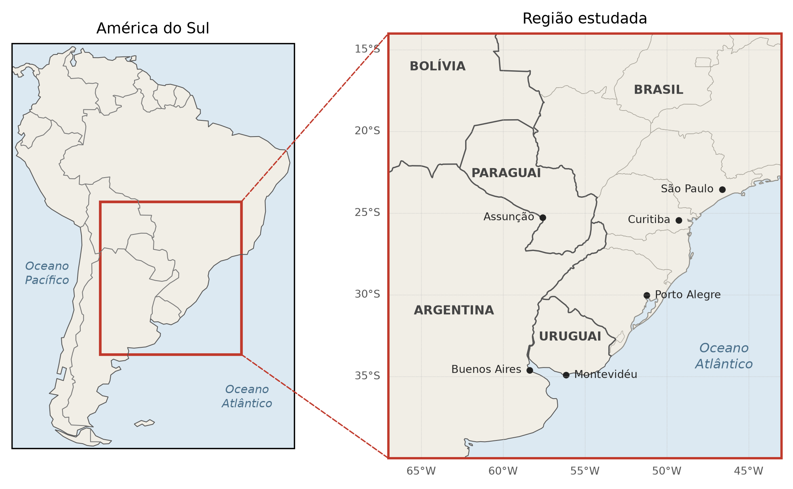
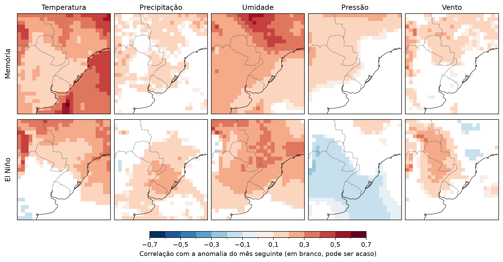

# Onde há pistas para prever o mês seguinte?

Uma primeira olhada nas cinco variáveis do projeto de mestrado *Modelagem de Padrões Espaço-Temporais para Previsão Subsazonal de Variáveis Meteorológicas* (INPE), no Sudeste da América do Sul.

## A ideia

Antes de treinar qualquer modelo de previsão, quis saber onde existe alguma pista para prever o mês seguinte em cada uma das cinco variáveis do projeto, que são temperatura do ar, precipitação, umidade específica, pressão e vento. Olhei duas pistas simples.

- **Memória.** Quando um mês fica acima do normal, o mês seguinte também tende a ficar?
- **El Niño.** O aquecimento do Oceano Pacífico em um mês diz algo sobre o mês seguinte aqui?

Usei os dados mensais do ERA5 de 1979 a 2025, na mesma região da iniciação científica do Cláudio Duarte.



## O que encontrei



A temperatura do ar é a variável com mais memória, principalmente sobre o oceano. A umidade específica lembra mais sobre o continente. A precipitação quase não tem memória, mas o El Niño ajuda a prevê-la em metade da região. A pressão e o vento têm pouca memória, e sobre o oceano o vento não tem nenhuma.

## Arquivos

- [`notebooks/cinco_variaveis.ipynb`](notebooks/cinco_variaveis.ipynb) traz o passo a passo e o código.
- [`docs/cinco_variaveis/`](docs/cinco_variaveis/01.pdf) traz o resumo em PDF.

Para rodar o notebook, você vai precisar do [`uv`](https://docs.astral.sh/uv/) e de uma conta no [Copernicus CDS](https://cds.climate.copernicus.eu), com a chave salva em `~/.cdsapirc`. Ele baixa os próprios dados.

```bash
uv sync
uv run --with jupyter jupyter lab notebooks/cinco_variaveis.ipynb
```

O código está sob a licença MIT.
